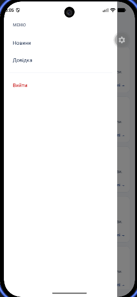

# Лабораторна робота №2
## Мобільний застосунок із навігацією та авторизацією

### 1. Мета роботи

Ознайомитися з можливостями Expo Router для організації навігації в мобільному застосунку, реалізувати авторизацію користувача, захист маршрутів, відображення списків даних та перехід до детальної інформації.

### 2. Опис проєкту

У межах лабораторної роботи розроблено мобільний застосунок на React Native з використанням Expo Router і TypeScript.

Застосунок містить такі функціональні можливості:

- **Авторизація:** екран входу з полями email і пароля та перевіркою їх заповнення.
- **Контекст авторизації:** керування станом входу та виходу за допомогою `AuthContext`.
- **Захищені маршрути:** перенаправлення неавторизованих користувачів на сторінку входу.
- **Бічне меню:** навігація між розділами «Новини» та «Довідка».
- **Стрічка новин:** відображення понад 100 елементів за допомогою `FlatList`.
- **Оновлення та дозавантаження:** оновлення списку потягуванням униз і завантаження додаткових новин під час прокручування.
- **Детальна сторінка:** відкриття новини за динамічним параметром `id`.
- **Довідковий центр:** групування запитань і відповідей за категоріями за допомогою `SectionList`.
- **Оптимізація:** використання `React.memo` та `getItemLayout`.
- **Безпечна область:** використання `SafeAreaView` для врахування системних відступів.

Авторизація в поточній версії є демонстраційною: перевіряється заповнення полів, але справжня автентифікація через сервер не виконується.

### 3. Використані технології

- React Native
- Expo
- Expo Router
- TypeScript
- React Hooks
- `FlatList`
- `SectionList`
- `React.memo`
- `react-native-safe-area-context`

### 4. Структура проєкту

```text
src/
├── context/
│   └── AuthContext.tsx
├── components/
│   └── NewsCard.tsx
└── app/
    ├── _layout.tsx
    ├── login.tsx
    └── (drawer)/
        ├── _layout.tsx
        ├── faq.tsx
        └── (news)/
            ├── _layout.tsx
            ├── index.tsx
            └── [id].tsx
```

### 5. Інструкція із запуску

**Крок 1.** Встановити Node.js та npm.

**Крок 2.** Відкрити термінал у папці проєкту, де розташований файл `package.json`.

**Крок 3.** Встановити залежності:

```bash
npm install
```

**Крок 4.** Запустити проєкт:

```bash
npx expo start
```

**Крок 5.** Відкрити застосунок за допомогою Expo Go або запустити його в емуляторі, дотримуючись інструкцій у терміналі.

### 6. Скріншоти роботи застосунку

Додати скріншоти, які демонструють основні функції розробленого застосунку.

#### 6.1. Екран авторизації


*Рисунок 1 — Екран входу до застосунку.*

#### 6.2. Стрічка новин


*Рисунок 2 — Список новин із можливістю прокручування.*

#### 6.3. Детальна сторінка новини


*Рисунок 3 — Відображення окремої новини за її ідентифікатором.*

#### 6.4. Бічне меню



*Рисунок 4 — Навігаційне меню застосунку.*

#### 6.5. Довідковий центр


*Рисунок 5 — Список запитань і відповідей, згрупованих за категоріями.*

### 7. Контрольні запитання та відповіді

**1. Як працює вкладена навігація в архітектурі Expo Router?**

Expo Router використовує файлову систему для формування маршрутів. Файли та папки в директорії `app` відповідають екранам і групам маршрутів. Файл `_layout.tsx` визначає структуру навігації для відповідної частини застосунку.

Вкладена навігація дає змогу поєднувати різні типи навігаторів. Наприклад, у цьому проєкті використовується `Drawer` для бічного меню та вкладений `Stack` для сторінок новин. Це дає змогу організувати переходи між розділами та відкривати детальні сторінки.

**2. Яким чином реалізується захист маршрутів від неавторизованого доступу?**

Захист маршрутів реалізовано за допомогою контексту React `AuthContext`, який зберігає стан авторизації `isAuthenticated` і надає функції `login()` та `logout()`.

У файлі `_layout.tsx` захищеної групи маршрутів перевіряється стан авторизації. Якщо користувач не авторизований, застосунок перенаправляє його на екран входу за допомогою `Redirect`. Після успішного входу користувач отримує доступ до основних розділів, а після виходу знову перенаправляється на сторінку авторизації.

**3. Чим FlatList відрізняється від ScrollView та що таке віртуалізація списків?**

`ScrollView` відображає всі свої дочірні елементи одночасно. Тому для великих списків він може використовувати більше пам'яті та ресурсів.

`FlatList` призначений для відображення списків і використовує віртуалізацію: він переважно створює та утримує в пам'яті елементи, які потрібні для поточного відображення, замість одночасного рендерингу всього списку. Це допомагає підвищити продуктивність.

У проєкті `FlatList` використовується для стрічки новин, а `getItemLayout` допомагає оптимізувати визначення розташування елементів.

**4. Як отримати параметри динамічного маршруту на цільовому екрані в Expo Router?**

Для створення динамічного маршруту використовується файл із параметром у квадратних дужках, наприклад `[id].tsx`.

На цільовому екрані параметр отримують за допомогою хука `useLocalSearchParams` з бібліотеки `expo-router`.

Приклад:

```tsx
import { useLocalSearchParams } from 'expo-router';

export default function NewsDetailsScreen() {
  const { id } = useLocalSearchParams<{ id: string }>();

  return null;
}
```

У цьому проєкті параметр `id` використовується для визначення номера новини, яку відкрив користувач.

**5. Яку структуру даних приймає компонент SectionList?**

`SectionList` приймає масив секцій у властивості `sections`. Кожна секція зазвичай містить заголовок `title` і масив елементів `data`.

Приклад:

```tsx
const sections = [
  {
    title: 'Робота із застосунком',
    data: [
      {
        question: 'Як відкрити новину?',
        answer: 'Натиснути на потрібну картку новини.',
      },
    ],
  },
  {
    title: 'Навігація',
    data: [
      {
        question: 'Як повернутися до новин?',
        answer: 'Відкрити бічне меню та вибрати «Новини».',
      },
    ],
  },
];
```

Для відображення заголовків секцій використовується `renderSectionHeader`, а для окремих елементів — `renderItem`. У розробленому застосунку `SectionList` використовується для групування запитань і відповідей у довідковому центрі.

### 8. Висновки

Під час виконання лабораторної роботи розроблено мобільний застосунок із демонстраційною авторизацією, захистом маршрутів і вкладеною навігацією за допомогою Expo Router.

Реалізовано стрічку новин із оновленням і дозавантаженням елементів, динамічні сторінки новин та довідковий центр із групуванням запитань. Для підвищення продуктивності застосовано `FlatList`, `getItemLayout` і `React.memo`.

У результаті отримано практичні навички побудови структури мобільного застосунку, керування станом авторизації, роботи з динамічними маршрутами та оптимізації відображення списків.
